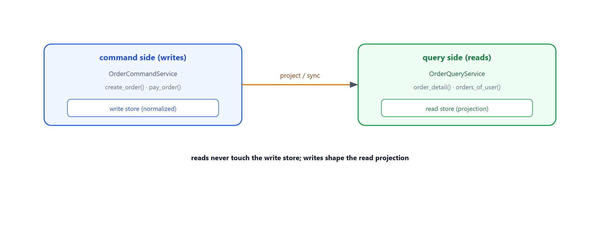
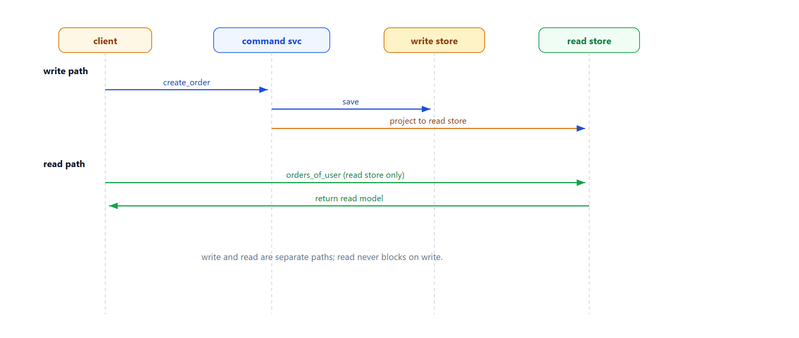

# Learn CQRS — Command Query Responsibility Segregation

> **Learning / study repo. Self-contained demo, NOT production code.**
> Writes and reads use different models. Commands update the write store and project into a
> read-optimized view; queries read only from that view. Read and write scales independently.

## The idea

```
  command side (writes)              query side (reads)
  ┌──────────────────┐               ┌──────────────────┐
  │ OrderCommandSvc  │──project──►   │ OrderQuerySvc    │
  │  create_order()   │               │  order_detail()  │
  │  pay_order()      │               │  orders_of_user()│
  └────────┬─────────┘               └────────┬─────────┘
           │                                  │
           ▼                                  ▼
      write store                         read store (projection)
      (normalized)                         (flattened, optimized for reads)
```

- **Commands** change state; they never return data.
- **Queries** read state; they never change it.
- The read store is a projection, rebuilt/refreshed from writes.
- Read and write can scale separately, even use different databases.



## Why this matters

- **Read-heavy workloads** — optimize the read side for fast queries without complicating writes.
- **Independent scaling** — scale read replicas separately from write nodes.
- **Clean separation** — write logic and read shaping don't fight each other.

## Run

```bash
python run_all.py
```

Pure Python standard library.

## Demo cases

1. **Write commands** — create orders; write store updated, read projection built.
2. **Read queries** — list user orders and order detail from the read store only.
3. **Pay command** — status changes; read projection reflects PAID.

## Flow



## Sibling repos

- `learn_event_sourcing` — state as events; CQRS reads from event projections.
- `learn_saga_orchestration` — cross-service command flows.
- `learn_microservice_by_id` — services split by domain, each with its own store.
